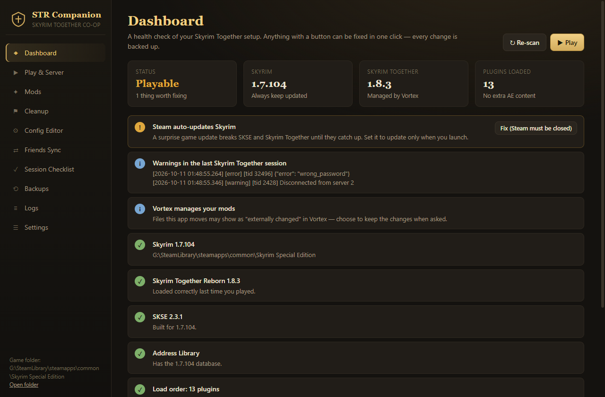
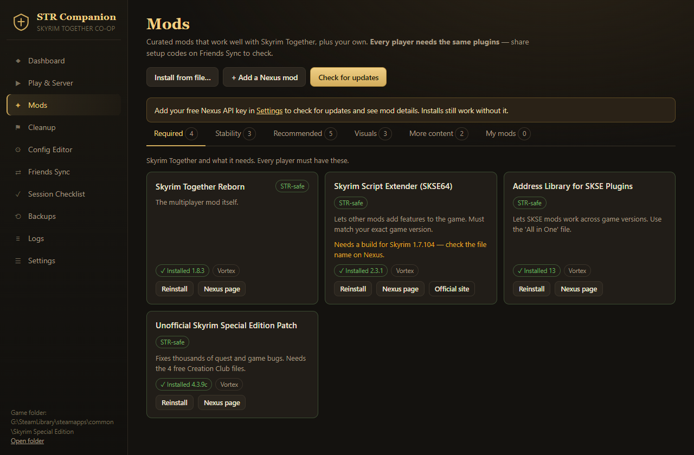
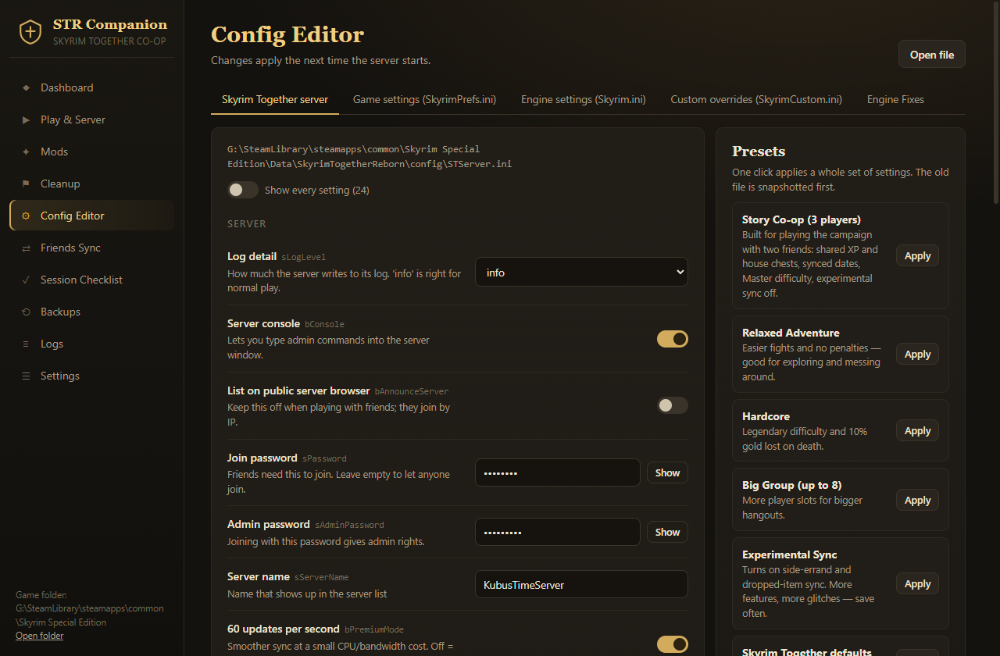
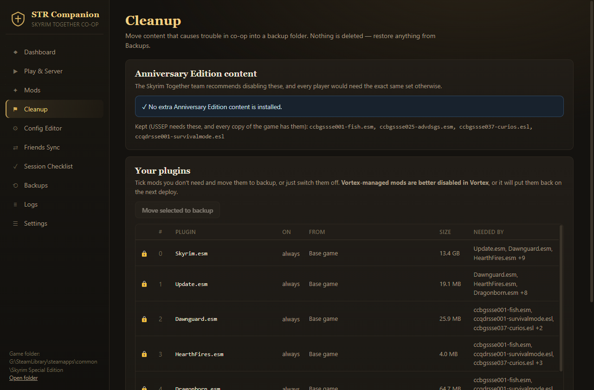
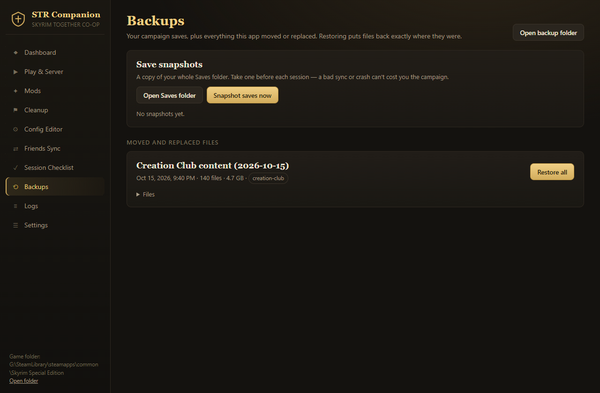

<div align="center">

# 🛡️ STR Companion

**The all-in-one setup, cleanup and launch companion for _Skyrim Together Reborn_ co-op.**

Get your whole group onto the same setup, fix what breaks co-op, and play the campaign together, without digging through INI files and log folders.

[](https://github.com/clawdroppin/str-companion/releases/latest)

-2a251e?style=flat-square)
[](LICENSE)



</div>

---

## ⬇️ Download

1. Go to **[Releases](https://github.com/clawdroppin/str-companion/releases/latest)** and download **`STR-Companion-x.y.z.exe`**.
2. Run it. It's portable, so there's nothing to install.
   - Windows may show **"Windows protected your PC"** because the app isn't code-signed. Click **More info → Run anyway**.
3. The app finds Skyrim automatically through Steam. If it doesn't, point it at the folder that contains `SkyrimSE.exe`.

> **Everyone in your group should use it.** The best part is **Friends Sync**, which shows exactly what's different between your setups.

---

## ✨ What it does

| | |
|---|---|
| 🩺 **Dashboard** | Health check of your whole setup: game version, SKSE, Address Library, Skyrim Together, **missing master files** (the #1 cause of startup crashes), problem mods, Anniversary Edition content, and Steam auto-updates. Most problems have a **one-click fix**. |
| ▶️ **Play & Server** | Launch Skyrim Together, start, stop or restart your server, copy your `IP:port` for friends, and see who's connected live. |
| 🧩 **Mods** | A curated catalog (Required · Stability · Recommended · Visuals · More content), each labeled by Skyrim Together compatibility. **Install, update-check and uninstall** in one place. Add any Nexus mod by link, or install from an archive. For SKSE mods, it shows whether they **actually loaded** on your game version. |
| 🧹 **Cleanup** | Moves Anniversary Edition add-ons into a backup, **keeping the 4 free ones USSEP needs**. Also flags known-incompatible mods, and lets you switch off or set aside any plugin, with a warning if other mods depend on it. |
| ⚙️ **Config Editor** | Friendly editors with plain-English descriptions for `STServer.ini`, `SkyrimPrefs.ini`, `Skyrim.ini`, `SkyrimCustom.ini` and Engine Fixes. **One-click presets** include *Story Co-op (3 players)*, *Hardcore*, *Big Group*, *Performance* and *Quality*, and you can save your own. |
| ⇄ **Friends Sync** | Each player copies a short `STR1-…` setup code. Paste a friend's code to see mismatched game versions, missing plugins and load order differences. |
| 💾 **Backups** | **Save snapshots** before each session, plus a restorable history of every file the app moved or replaced. |
| ✅ **Session Checklist** | The pre-session routine that keeps quests in sync, plus a stuck-quest helper. |
| 📜 **Logs** | Server, client, SKSE and Engine Fixes logs in one place. |

### 🔒 Safe by design
- **Nothing is ever deleted.** Files are *moved* to `<Skyrim>\_STRCompanion_Backup\`, with a manifest so every batch can be restored.
- Config files are **snapshotted before every save**.
- Base-game files and the plugins Skyrim Together needs are **locked** and can't be moved.
- INI saves are **blocked while Skyrim is running**, because the game would overwrite them on exit.
- Your Nexus API key is stored encrypted with Windows' secure storage and only sent to `nexusmods.com`.

<details>
<summary><b>📸 More screenshots</b></summary>

| Mods | Config Editor |
|---|---|
|  |  |
| **Cleanup** | **Backups** |
|  |  |

</details>

---

## 🎮 Quick start for a campaign with friends

1. **Everyone:** open STR Companion and go through the **Dashboard** until everything is green or yellow.
2. **Everyone:** **Cleanup → Move Anniversary add-ons to backup**, unless you all own and enable exactly the same ones.
3. **Everyone:** **Friends Sync**. Post your code in your group chat, then paste each friend's code. Fix anything marked **Fix**.
4. **Host:** **Config Editor → Skyrim Together server → Story Co-op (3 players)**, then set a join password.
5. **Host:** **Play & Server → Start server**. Share your `IP:port` (forward the port on your router, or use Tailscale or ZeroTier).
6. **Everyone:** **Backups → Snapshot saves now**, then **Launch Skyrim Together** and connect with **F2**.
7. Pick **one party leader** for the whole campaign. Quest progress syncs from them.

## 🔑 Nexus Mods integration

Add your **personal API key** (Nexus → *Settings → API keys*) under **Settings** to enable update checks and mod details.

- **Premium accounts:** installs download directly.
- **Free accounts:** the app opens the mod's Nexus page. Click **Manual download**, and the app picks up the file from your Downloads folder and offers to install it.
- Mods with an installer that has options (FOMOD) should be installed with **Vortex** instead. The app tells you when that's the case.
- `.rar` archives need [7-Zip](https://www.7-zip.org/) installed. `.7z` and `.zip` work out of the box.

## ❓ FAQ

<details><summary><b>I use Vortex. Will this conflict?</b></summary>

No. The app detects Vortex-managed mods and reads their versions, and it sends you to Vortex to update those. If you move a Vortex-managed file, Vortex may say it was "changed externally". Choose to keep the change, or better, disable that mod in Vortex.
</details>

<details><summary><b>Why does it say my SKSE mod "needs a build for my game version"?</b></summary>

SKSE plugins (`.dll` files) are tied to specific game versions. After you launch the game once, the card shows **"Loads on your game"** or **"Didn't load"** based on the SKSE log.
</details>

<details><summary><b>How do I undo something?</b></summary>

**Backups → Restore all**, or restore single files. Uninstalling a mod also puts back any original files it had replaced.
</details>

<details><summary><b>Steam updated Skyrim and now nothing works!</b></summary>

SKSE and Skyrim Together need updates for each new game version. The Dashboard can set Steam to **"Only update when I launch"** (close Steam first) so this doesn't happen mid-campaign.
</details>

---

## 🛠️ Building from source

Requires **Node.js 20+** on Windows.

```bash
npm install
npm start          # run the app
npm test           # unit tests (use a fake game folder in %TEMP%, never your real install)
npm run dist       # build the portable exe into dist/
```

Contributors and AI agents: read **[AGENTS.md](AGENTS.md)** first. It covers the architecture, the safety rules the code relies on, and how to verify the UI.

---

<sub>STR Companion is an unofficial fan tool. It is not affiliated with the Tilted Phoques team (Skyrim Together Reborn), Bethesda, or Nexus Mods. Mod recommendations come from the Skyrim Together FAQ and community reports, so test before long sessions.</sub>
